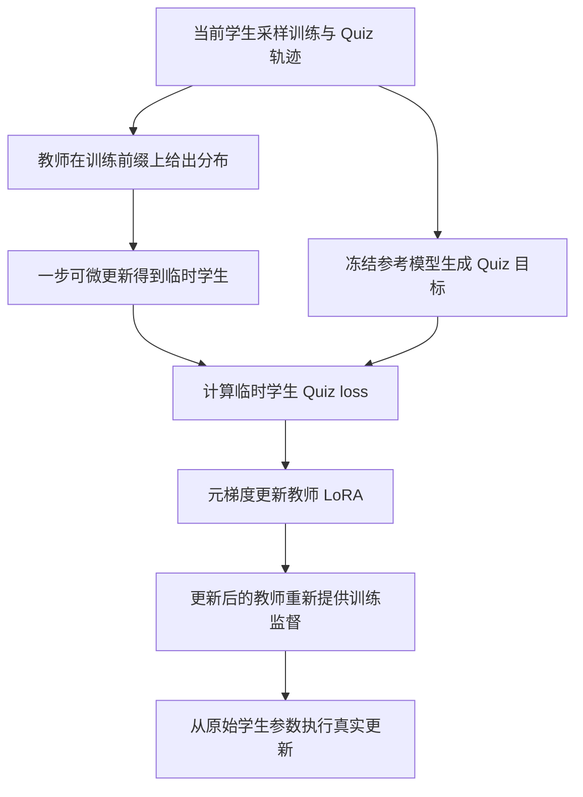

# 双路 OPSD 单卡实验搭建方案

建议先建立一个轻量研究仓库：PyTorch 控制训练循环，Transformers 加载骨干，PEFT 管理双 LoRA；配置、算法、数据和评测分开，共约 10 个核心 Python 文件。第一版实现固定教师 OPSD 与教师元优化，使用 Qwen2.5-Math-1.5B-Instruct 和单张 RTX 3090。学生侧监督选择与 PRM 留在第二阶段。

本方案给出待实现的代码组织、接口与验收标准。目录和命令是目标设计，目前不代表训练程序已经实现或已在 3090 上验证。

# 仓库结构与技术选择

参考 [TRL](https://github.com/huggingface/trl) 与 [verl](https://github.com/verl-project/verl) 将配置、训练入口、训练器、模型与数据分开的组织方式，缩减为单卡研究项目。采用它们的组织思路，不宣称复现某篇论文的代码，也不直接继承分布式调度系统。

```text
dual_opsd/
├── README.md
├── pyproject.toml
├── requirements-lock.txt
├── configs/
│   ├── debug_3090.yaml
│   ├── opsd_math.yaml
│   └── meta_math.yaml
├── dual_opsd/
│   ├── __init__.py
│   ├── data.py
│   ├── prompts.py
│   ├── models.py
│   ├── rollout.py
│   ├── losses.py
│   ├── meta.py
│   ├── trainer.py
│   ├── evaluation.py
│   └── utils.py
├── scripts/
│   ├── prepare_data.py
│   ├── train.py
│   ├── evaluate.py
│   └── profile_step.py
├── tests/
│   ├── test_meta_gradient.py
│   └── test_alignment.py
├── docs/
│   └── experiment_plan.md
├── data/
│   └── processed/
└── outputs/
```

包内 9 个主要模块承载算法；scripts 只负责解析配置和调用接口。无需给每个函数新建文件，也无需先做通用 BaseTrainer 或插件系统。第二阶段确有需求时再添加 selection.py。

建议环境为 Linux、Python 3.11、匹配驱动的 CUDA 版 PyTorch，配合 transformers、peft、datasets、safetensors、PyYAML、numpy、tqdm、pytest，以及统一的数学答案判分器。安装后先跑元梯度测试，再锁定准确版本到 requirements-lock.txt；记录 CUDA、驱动和模型 revision。这里不预设未经兼容性验证的依赖版本组合。

参考模型是关闭两个适配器的冻结初始骨干。第一版不增加第三份完整模型，不加载 PRM，不启用量化、vLLM、分布式训练或 torch.compile。先确认高阶梯度正确，再逐项测量优化收益。

# 各文件的职责

| 文件 | 负责的内容 | 建议对外接口 |
| --- | --- | --- |
| data.py | 读取统一数据、抽样、collator、生成 token 对齐信息 | load_splits、build_batch |
| prompts.py | 学生提示、教师特权提示、模板版本 | student_prompt、teacher_prompt |
| models.py | 加载一次骨干、创建双 LoRA、按角色前向、临时参数前向 | build_model、student_forward、teacher_forward、reference_forward |
| rollout.py | 当前学生采样、停止条件、生成长度与截断记录 | sample_rollouts |
| losses.py | token 对齐后的 KL、mask、序列归一化、SFT loss | distillation_loss、quiz_loss |
| meta.py | 一步可微学生更新、Quiz 教师梯度 | virtual_update、teacher_meta_grad |
| trainer.py | 串联 OPSD 或元优化循环，执行真实参数更新 | train_step、fit |
| evaluation.py | 纯学生生成、答案提取、统一判分、指标汇总 | evaluate_student |
| utils.py | 随机种子、配置、日志、保存和恢复 | seed_all、save_checkpoint、load_checkpoint |

data.py 不计算训练损失，losses.py 不调用 optimizer，meta.py 不保存文件，trainer.py 不直接写 tokenizer 的底层对齐逻辑。边界清楚比增加抽象层更重要。

scripts/train.py 的职责应只有：读取 YAML → 设置种子 → 创建数据、模型和 trainer → fit。固定教师与元优化共用同一个 Trainer，通过 method 选择分支，确保它们使用相同的数据、提示、rollout 和 KL 实现。SFT 也可走相同入口的独立分支。

使用 PEFT 双适配器时，将学生和教师参数按名字显式分组。不要只在切换适配器后用 requires_grad 过滤一次便创建全部 optimizer，因为适配器切换可能改变可训练状态。每次阶段切换都要检查角色、参数组与梯度权限。[PEFT 适配器管理说明](https://huggingface.co/docs/peft/en/package_reference/peft_model)

# 数据与 token 对齐

主任务使用 MATH 原始训练集，按学科、难度分层固定划分 6000 道蒸馏题、1000 道元训练 Quiz、500 道开发题。MATH-500 用于最终快速测试，最终选定配置再测完整 MATH test。开发集负责超参数和 checkpoint 选择；Quiz 只负责教师元训练，不能用作最终验证结果。

数据来源和字段可参考 [MATH](https://huggingface.co/datasets/EleutherAI/hendrycks_math) 与 [MATH-500](https://huggingface.co/datasets/HuggingFaceH4/MATH-500)。完整 MATH test 与 MATH-500 有重叠，分别报告，不视为独立测试证据。

prepare_data.py 统一输出如下字段：
```json
{
  "id": "math/train/algebra/example_id",
  "problem": "...",
  "solution": "...",
  "answer": "...",
  "subject": "algebra",
  "level": 3,
  "source_split": "train"
}
```

同时保存 distill.jsonl、quiz.jsonl、dev.jsonl、test.jsonl 和 manifest.json。manifest 记录原始数据 revision、划分种子、题目 ID、文件 hash、排重与长度过滤统计。先按题目划分，再在各自集合内筛选；同一题的不同解法不能跨集合。数据处理时验证原始总数及最终数量，不假设过滤后仍恰好是 6000/1000/500。

主实验特权信息为参考解答与最终答案；答案单独作为一个消融版本。solution 和 answer 不允许进入学生推理提示。教师提示明确标注参考材料，并要求基于学生当前前缀继续解题，以便研究错误前缀下的监督行为。

最重要的对齐规则：同一条学生生成 continuation 只 tokenize 一次，再分别拼接到学生提示与教师提示之后。两侧提示长度不同，不能拿相同绝对位置的 logits 直接计算 KL；根据各自 continuation 起点抽取对应的预测位置，并检查 causal shift。生成 token y[t] 应由其前一个位置的 logits 预测。

只对有效生成 token 计算损失，屏蔽题目、参考解答和 padding；EOS 是否纳入由统一配置明确规定。先对每条生成序列取平均，再对题目取平均，防止长答案支配 batch。

3090 的 512 tokens 是单次前向的总长度预算。先构造满足教师侧预算的短题调试子集，完整保留题目与参考解答，并给生成过程留足空间；超长样本跳过并记录，不静默截掉答案。这个子集只用于工程验证。正式训练扩大长度后沿用同一划分；若仍筛选，所有方法使用完全相同的筛选集并报告覆盖率。测试集不按易题或短题筛选。

# 一次训练循环与梯度路径

每步开始时，真实学生参数为 theta，教师参数为 phi，冻结骨干为 W0。学生、教师分别启用 student 和 teacher 适配器，reference 关闭两个适配器。LoRA dropout 设为 0，避免角色比较混入随机 dropout。



具体顺序如下：

1. 从 D 和 Q 各抽取一个 batch。当前真实学生在两批题目上生成轨迹，采样过程不保留梯度；本轮后续阶段固定使用这些 token。
2. 冻结参考模型在 Quiz 轨迹前缀上计算特权分布 q_ref，使用 no_grad 并 detach。参考权重固定，目标仍会随题目和当前轨迹变化，不能误以为可以跨训练过程永久缓存每题一份 logits。
3. 教师在训练轨迹前缀上计算特权分布，并与学生分布计算 L_KD。此处教师分布必须保留梯度。
4. 通过 autograd.grad(L_KD, student_params, create_graph=True) 得到学生梯度；构造 fast_params = theta - inner_lr * grad，不写回真实参数。
5. 使用 fast_params 在固定 Quiz 前缀上计算 L_Quiz；仅将相对于 teacher_params 的元梯度写给教师优化器，随后更新教师。更新前的 Quiz loss 可在 no_grad 下计算，用于日志中的 learning progress。
6. 丢弃临时学生图。真实学生仍保持 theta。使用更新后的教师，在同一训练轨迹上重新前向；此时教师输出 detach，再执行真实学生更新。

第一版采用内层 SGD、真实学生 SGD，令两者学习率相同，尽量对齐模拟与实际更新；教师使用 AdamW。若后续真实学生改为 AdamW，应单独说明并消融模拟更新与真实更新之间的差异。

关键梯度权限：

| 阶段 | 学生 | 教师 | 骨干 |
| --- | --- | --- | --- |
| rollout 与 reference 目标 | 不建图 | 不建图 | 冻结 |
| 临时学生蒸馏 | 保留可微更新路径 | 必须保留梯度 | 权重冻结，但不能屏蔽适配器所需的前向图 |
| Quiz 教师元更新 | 经 fast_params 传递，不更新真实学生 | 接收元梯度 | 冻结 |
| 真实学生更新 | 接收梯度并更新 | 输出 detach | 冻结 |

临时更新不能调用普通 optimizer.step、load_state_dict、.data 或 copy_ 写入参数，也不能 detach 内层学生梯度。这些操作会破坏预期的教师反馈路径。

推荐以 [torch.func.functional_call](https://docs.pytorch.org/docs/stable/generated/torch.func.functional_call.html) 实现临时参数前向，用 [torch.autograd.grad](https://docs.pytorch.org/docs/stable/generated/torch.autograd.grad.html) 计算可微内层梯度。functional_call 只替换提供的参数，未替换的冻结骨干继续共用，不需要深拷贝整个模型。处理好权重绑定，并验证 PEFT 包装器中的参数名映射。

共享骨干意味着适配器状态也是共享可变状态。最初在每次前向前显式选择角色、设置并检查梯度权限；先完成全部教师元梯度求解，再进入真实学生更新。初版关闭 gradient checkpointing，以免 backward 重算时读到已经切换的适配器。以后启用时，重算函数必须固定角色和 fast_params，并使用经过高阶梯度测试的实现；functional_call 本身不会替你固定全局适配器开关。

固定教师 OPSD 分支跳过临时学生和 Quiz 元更新，教师输出直接 detach，其余采样与真实学生损失保持一致。

# 损失定义与配置

losses.py 先实现经过对齐和 mask 的标准 forward KL，作为数值与梯度参考实现。你的原稿写了 clipped forward KL，但还没有完整给出 clipping 公式；正式使用前必须确定裁剪对象、阈值、归一化和裁剪区间的梯度处理。不能用一个任意 clamp 冒充原方法。

固定教师与元优化必须使用相同的损失版本。标准 KL 可作为明确命名的实验设定；它不等于已经复现原稿所称的 clipped OPSD。若添加 clip，再保留标准 KL 做消融，记录被裁剪 token 的比例。数学计算中的 softmax、log_softmax 和 KL 归约优先用 FP32。

配置示例是首轮调试配置，数值需要开发集和性能测量后调整：
```yaml
experiment:
  name: meta_math_debug
  method: meta_opsd       # initial_eval | sft | opsd | meta_opsd
  seed: 42

model:
  name: Qwen/Qwen2.5-Math-1.5B-Instruct
  revision: null         # 开跑前替换并锁定实际 revision
  dtype: bfloat16
  attention_backend: eager
  lora:
    rank: 8
    alpha: 16
    dropout: 0.0
    targets: [q_proj, v_proj]

data:
  root: data/processed/math
  subset: debug_short
  privilege: solution_and_answer

rollout:
  temperature: 0.7
  top_p: 0.95
  max_new_tokens: 128
  max_total_tokens: 512   # 教师与学生分别检查；不能只看输出长度

train:
  max_steps: 100
  inner_batch_size: 1
  quiz_batch_size: 1
  inner_steps: 1
  inner_optimizer: sgd
  student_optimizer: sgd
  inner_lr: 0.0001
  student_lr: 0.0001
  teacher_optimizer: adamw
  teacher_lr: 0.00001
  teacher_weight_decay: 0.0
  gradient_checkpointing: false
  use_cache_for_training: false

loss:
  kind: forward_kl
  temperature: 1.0
  reduction: mean_per_sequence

evaluation:
  decoding: greedy
  max_new_tokens: 1024

logging:
  output_root: outputs
  save_every: 50
```

eager attention 是优先检查高阶梯度的起点，不是性能最优承诺。通过测试后再比较其他后端。生成阶段可在 no_grad 下使用 KV cache；带梯度训练阶段关闭 cache。初版使用 BF16 骨干和 FP32 LoRA 参数；显式检查加载后 dtype，而不是只相信配置。

普通梯度累积不能消除内层大 batch 的计算图开销。初版保持内层与 Quiz batch 均为 1；若积累多个独立教学任务的外层梯度，明确它不是一次大 batch 内层更新。

正式配置独立保存为 opsd_math.yaml、meta_math.yaml，展开后应只在方法所需字段上不同。避免多层配置继承；每次运行保存完整解析结果。

# 实现顺序与验收

| 阶段 | 完成的内容 | 通过标准 |
| --- | --- | --- |
| 1 | 数据、提示、初始学生评测 | 可重复划分；能生成并判分；学生提示不含特权信息 |
| 2 | 双适配器、标准 KL、固定教师 OPSD | 只改变学生 LoRA；无位置错位；参考和教师参数不变 |
| 3 | 小模型上的一步可微更新 | fast_params 不污染真实参数；教师梯度与有限差分一致 |
| 4 | 1.5B 上的完整元训练步骤 | 更新教师后再更新学生；无断图；显存与耗时有实测记录 |
| 5 | 短序列小规模实验 | 100 步无 NaN；loss 和梯度有限；保存恢复可继续 |
| 6 | 主实验与对照 | 同划分、同判分、可比较预算；关键结果 3 个种子 |
| 7 | 学生侧选择模块 | 加入 PRM，再比较固定加权与可学习选择 |

两个测试文件就够支撑第一阶段，但要测试真正影响结论的行为：

- test_meta_gradient.py：在极小随机模型上用 FP64、平滑标准 KL、固定 token，做教师元梯度的方向有限差分；使用非退化参数方向，避免 LoRA 零初始化导致的偶然零梯度。验证 inner_lr=0 时教师元梯度为零、正常设定下至少一部分教师梯度非零；临时更新前后真实学生与骨干逐参数不变。
- test_alignment.py：给教师增加一段特权提示，检查两侧同一个生成 token 仍然对齐；检查首 token、EOS、padding、causal shift 和特权材料 mask。手工小词表例子验证 KL 数值和归一化。

再加运行时断言：两组参数 ID 无交集；骨干不在 optimizer 中；元更新只改变教师，真实更新只改变学生；关闭适配器后参考输出稳定。开发阶段不要把所有异常梯度悄悄替换成零，先让断图问题显式报错。

profile_step.py 测量完整循环，包含训练与 Quiz rollout、参考目标、教师元更新和真实学生更新；不能只测一次 forward。预热后运行 50–100 步，记录均值、P50/P90、峰值 allocated/reserved 显存、实际 token 数和各阶段时间。CUDA 计时需同步或用 CUDA events。训练时间按实测循环数外推，不引用普通 SFT 吞吐量。

# 实验运行与结果管理

下列是完成实现后的预期命令接口：
```bash
python scripts/prepare_data.py --dataset math --seed 42
python -m pytest tests/test_alignment.py tests/test_meta_gradient.py
python scripts/evaluate.py --config configs/debug_3090.yaml --initial
python scripts/profile_step.py --config configs/debug_3090.yaml --steps 50
python scripts/train.py --config configs/opsd_math.yaml
python scripts/train.py --config configs/meta_math.yaml
python scripts/evaluate.py --run outputs/RUN_ID --split dev
python scripts/evaluate.py --run outputs/RUN_ID --split test
```

第一次只做 initial、固定 OPSD、meta OPSD，确认教师反馈路径和结果；正式报告补上 SFT，并匹配学生训练量、另做计算预算匹配比较。关键消融包括完整解答 vs 仅答案、Quiz 元更新有无、Quiz 大小。不要用“Quiz KL 降低”替代答题能力提升。

每次运行目录保存：
```text
outputs/RUN_ID/
├── config.yaml
├── environment.json
├── data_manifest.json
├── metrics.jsonl
├── checkpoints/
│   └── step_000100/
│       ├── student/
│       ├── teacher/
│       └── training_state.pt
└── evaluations/
    ├── dev_predictions.jsonl
    └── dev_summary.json
```

checkpoint 保存两套 LoRA、优化器、global_step、数据采样位置与 Python/NumPy/Torch/CUDA RNG 状态；骨干仅记录模型名、revision 与必要配置。恢复时核对数据 manifest、模型 revision 和损失版本。

训练日志至少记录 distill_loss、quiz_loss_before/after、learning_progress、teacher_meta_grad_norm、student_grad_norm、生成长度、截断率、跳过样本数、累计生成/训练 tokens、阶段耗时和峰值显存。Quiz KL 的数值应包含完整 KL；如果训练用省略目标熵的交叉熵，日志中另行区分。

评测只启用学生 LoRA，仅输入题目。开发集选择 checkpoint，测试集用于最终报告；主指标是无特权信息的最终答案正确率，同时报告答案提取失败率和截断率。统一数学等价判分实现及其版本，保存每题 prediction、抽取答案、gold 和判分结果。所有方法用相同提示和解码设置。预训练污染无法通过新划分消除，应将结论限定为这些公开基准上的后训练改进。

后续添加学生选择时，在 selection.py 实现步骤分数到监督权重的映射，rollout.py 输出步骤边界，losses.py 接收权重。PRM 冻结，训练时根据当前 rollout 计算分数；旧轨迹缓存不能冒充当前 on-policy 轨迹。比较固定 PRM 权重、可学习权重以及全 1 权重；测试仍不提供特权信息。

第一版的完成标志是：同一入口、同一数据与评测实现，可以运行固定教师 OPSD 和教师元优化；两个关键梯度与对齐测试通过；有真实的单步显存、耗时、checkpoint 与学生答题结果。

# 参考实现与接口

- [TRL 仓库](https://github.com/huggingface/trl)：训练入口与算法实现的分工参考。
- [verl 仓库](https://github.com/verl-project/verl)：配置、训练与 rollout 分工参考；单卡阶段只借鉴边界。
- [PyTorch functional_call](https://docs.pytorch.org/docs/stable/generated/torch.func.functional_call.html)：临时学生参数前向。
- [PyTorch autograd.grad](https://docs.pytorch.org/docs/stable/generated/torch.autograd.grad.html)：create_graph 可微内层梯度。
- [PEFT 模型接口](https://huggingface.co/docs/peft/en/package_reference/peft_model)：双适配器管理与保存。
- [Qwen2.5 Math 1.5B Instruct](https://huggingface.co/Qwen/Qwen2.5-Math-1.5B-Instruct)：共享冻结骨干。


